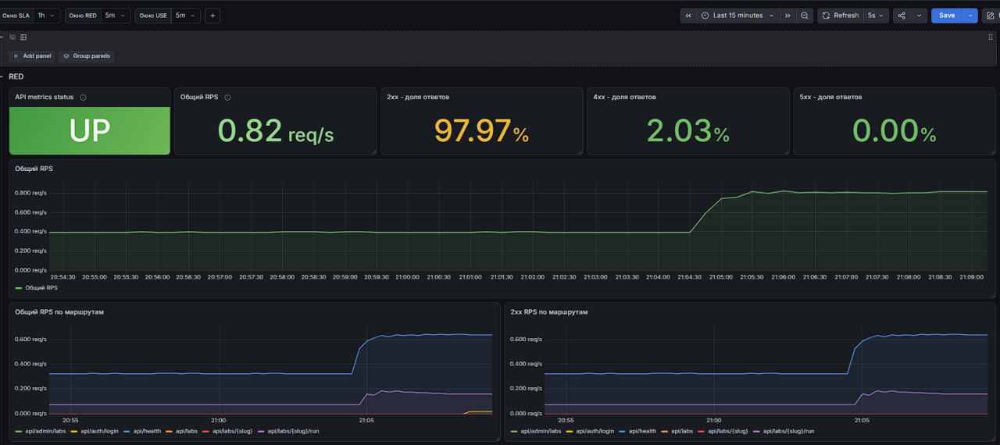
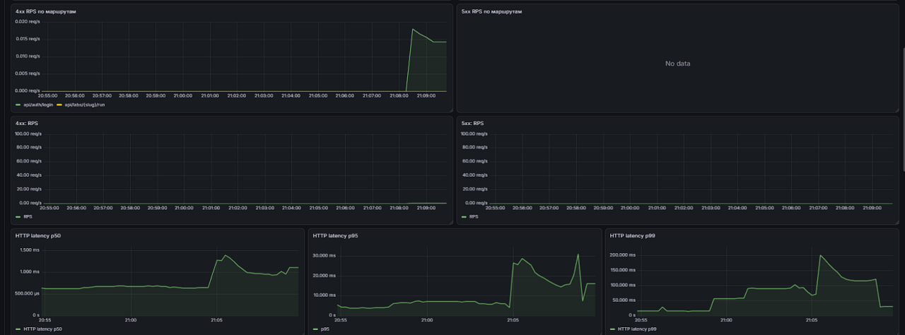
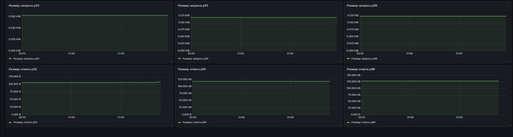
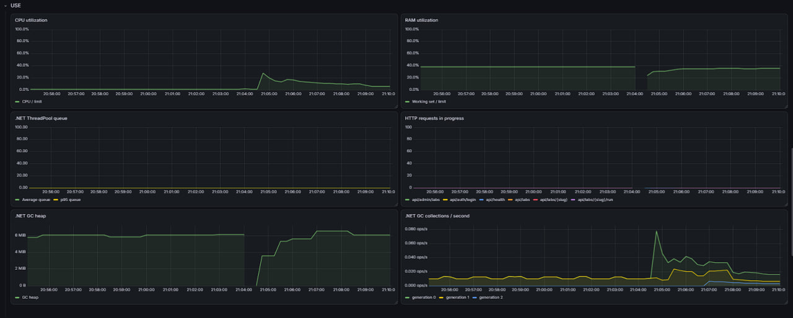
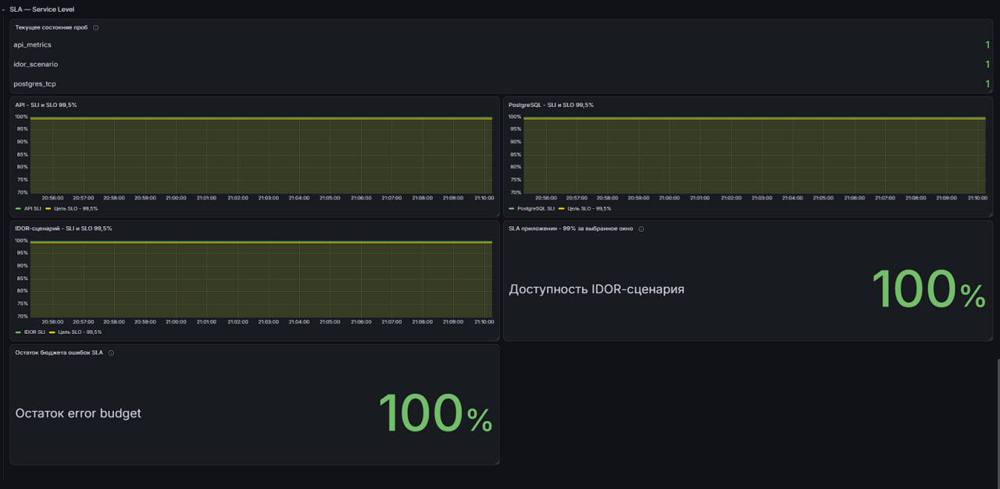
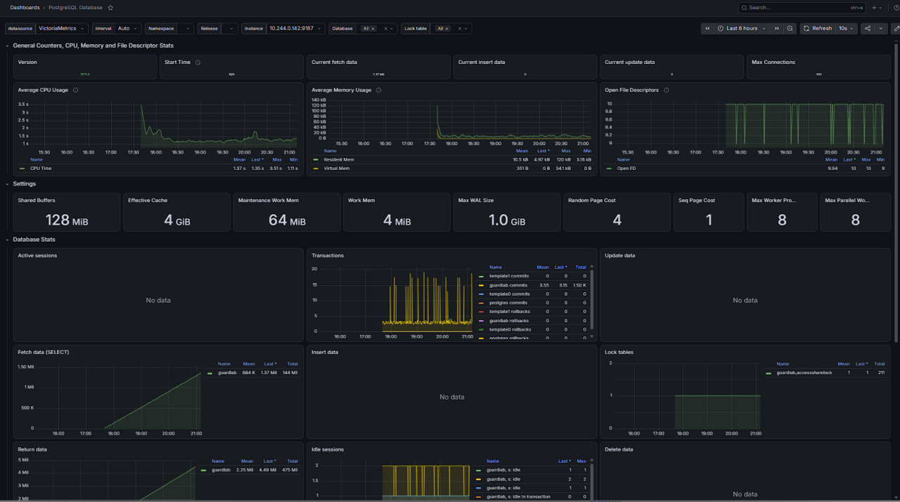
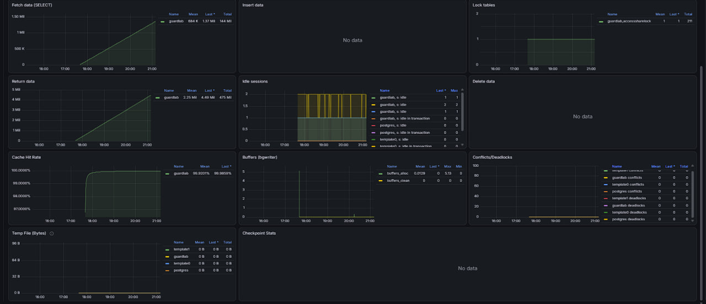

Отчёт по дашбордам Grafana

Метрики приложения GuardLab, его SLA-проб, .NET и постгри. в VM поступают данные API, runtime, проберов и postgres_exporter

В разделе RED: доступность сбора метрик API, общий RPS и доли ответов 2xx, 4xx и 5xx. 
Ниже есть графики количества запросов по маршрутам и классам ответов, а также отдельные графики RPS для 4xx и 5xx. 
Можно быстро понять, выросла ли нагрузка, на каких маршрутах возникают ошибки и меняется ли время ответа. 
Для времени ответа выведены p50, p95 и p99: они помогают увидеть как типичную задержку, так и более медленные запросы. 
Для размера запросов и ответов - перцентили. 
Размеры считаются по Content-Length, поэтому запросы и ответы без этого заголовка в эти показатели не попадают.

В некоторых графиках для 5xx по маршрутам отображается No data. На выбранном промежутке таких запросов не было, поэтому графику нечего показывать

В разделе USE собраны метрики использования ресурсов и очередей. 
CPU и RAM показывают нагрузку на приложение
Очередь .NET ThreadPool помогает заметить, что рабочие потоки не успевают разбирать поступающие задачи.
Запросы в обработке сгруппированы по маршрутам. График размера GC heap показывает объём управляемой памяти,а также частота сбора мусора.

Раздел SLA показывает результаты проверок проберов и рассчитанные показатели SLI/SLO для API, PostgreSQL и сценария IDOR.
Есть общий SLA сервиса и оставшийся бюджет ошибок. Для SLA можно выбрать своё окно расчёта независимо от RED и USE. В отчёте по SLA подробно описаны метрики для SLA

Для PostgreSQL импортировала готовый дашборд PostgreSQL Exporter - 9628
На нём можно посмотреть состояние базы, подключения, операции чтения и записи, блокировки, использование CPU и памяти, ecc

